# 🎯 Multi-LeadGen AI — Autonomous B2B Lead Generation, Qualification & Outreach Platform

[](https://github.com/JamilKhanEmon/multi-lead-gen/actions)
[](LICENSE)
[](https://nextjs.org/)
[](https://fastapi.tiangolo.com)
[](https://python.org)
[](https://www.postgresql.org/)
[](https://redis.io/)
[](https://www.docker.com/)

**Multi-LeadGen AI** is an enterprise-grade, autonomous B2B lead generation, intelligence gathering, deterministic qualification, and automated multi-channel outreach engine. 

The system automatically discovers prospective businesses across target industries and geographic regions, executes deep web crawling via autonomous headless browser agents, captures immutable visual screenshot evidence, evaluates leads across **135 deterministic parameters**, and orchestrates high-converting marketing campaigns (RFC 5322-compliant Cold Emails with Multi-Inbox Rotation & Human Approval Queue, Meta Ads copywriting, and AI Voice outreach).

---

## 📑 Table of Contents
1. [🏗️ End-to-End System Architecture](#-end-to-end-system-architecture)
2. [⚙️ Complete Tech Stack](#️-complete-tech-stack)
3. [🧠 Deep-Dive: Core Engines & Business Logic (A to Z)](#-deep-dive-core-engines--business-logic-a-to-z)
   - [1. Dynamic Discovery & Multi-Zone Expansion](#1-dynamic-discovery--multi-zone-expansion)
   - [2. Multi-Factor Deduplication & Aggregator Filtering](#2-multi-factor-deduplication--aggregator-filtering)
   - [3. Deep Web Scraping & Evidence Capture (OpenClaw)](#3-deep-web-scraping--evidence-capture-openclaw)
   - [4. 135 Deterministic Parameters & Audit Engine](#4-135-deterministic-parameters--audit-engine)
   - [5. Mathematical Scoring & Tier Qualification Gates](#5-mathematical-scoring--tier-qualification-gates)
   - [6. Deliverability-Engineered Cold Outreach (RFC 5322)](#6-deliverability-engineered-cold-outreach-rfc-5322)
   - [7. Unified Inbox & Client-Grouped Conversation Threading](#7-unified-inbox--client-grouped-conversation-threading)
   - [8. Granular RBAC Team Permissions Architecture](#8-granular-rbac-team-permissions-architecture)
   - [9. Meta Ads & AI Voice Agent Automation](#9-meta-ads--ai-voice-agent-automation)
   - [10. Autopilot Continuous Daemon & Task Queue](#10-autopilot-continuous-daemon--task-queue)
4. [📂 Exhaustive Project Directory Structure](#-exhaustive-project-directory-structure)
5. [🔄 Lead Lifecycle & State Transitions](#-lead-lifecycle--state-transitions)
6. [🚀 Local Development Setup Guide](#-local-development-setup-guide)
7. [🚢 Production VPS Deployment & CI/CD](#-production-vps-deployment--cicd)
8. [🔐 Complete Environment Variables Reference](#-complete-environment-variables-reference)
9. [🌐 API Endpoints Overview](#-api-endpoints-overview)
10. [📜 License](#-license)

---

## 🏗️ End-to-End System Architecture

```mermaid
flowchart TD
    subgraph UI ["Frontend Client (Next.js 15 + React 19)"]
        Dashboard["Admin / Dashboard / Inbox / Leads"]
        AppShell["AppShell (Auto-sync RBAC Permissions)"]
        WSClient["WebSocket Client (Live Log & Status Stream)"]
    end

    subgraph API_GW ["Backend API Gateway (FastAPI Async)"]
        RouterAuth["Auth & Team RBAC Router"]
        RouterLeads["Leads & Filter Management Router"]
        RouterAutopilot["Autopilot Control & Inbox Router"]
        RouterCampaigns["Meta Ads & Voice Campaign Router"]
        WSHub["WebSocket Connection Manager"]
    end

    subgraph Storage ["Data Layer"]
        Postgres[("PostgreSQL 16\n(Async SQLAlchemy 2.0 / Alembic)")]
        RedisQueue[("Redis 7\n(Async Job Queue & PubSub)")]
        EvidenceFS[("Local / Storage Volumes\n(Screenshots & Visual Evidence)")]
    end

    subgraph Workers ["Autonomous Worker Fleet"]
        WorkerRunner["Runner Daemon (runner.py)"]
        AutopilotDaemon["Autopilot Runner (autopilot_runner.py)"]
    end

    subgraph Engines ["Core Intelligence Engines"]
        Discovery["Discovery Optimizer (Google Maps & Search)"]
        Dedup["Deduplication Engine (Canonical Domain & Levenshtein)"]
        OpenClaw["OpenClaw Gateway Client (Headless Chromium)"]
        EvidenceEngine["Evidence & Parameter Evaluation Engine (135 Params)"]
        QualEngine["Qualification & Gatekeeper Scoring Engine"]
        Outreach["Outreach Engine (RFC 5322 Multipart & Multi-Inbox)"]
        MetaVoice["Meta Ads & AI Voice Modules"]
    end

    subgraph External ["External Services"]
        GoogleMaps["Google Maps API / Web"]
        Socials["Social Profiles (FB, IG, LinkedIn, X, TikTok, YT)"]
        TargetSites["Target Company Websites"]
        SMTPProviders["Live SMTP Servers (Gmail / SES / SendGrid / Custom)"]
        MetaGraph["Meta Marketing Graph API"]
        VoiceTwilio["AI Voice Agent Engine"]
    end

    UI <-->|REST API & WebSockets| API_GW
    API_GW <-->|Async Queries| Postgres
    API_GW <-->|Push / Pop Tasks| RedisQueue
    WorkerRunner <-->|Dequeue Tasks| RedisQueue
    AutopilotDaemon <-->|Orchestrate Cycles| API_GW

    WorkerRunner --> Discovery
    Discovery --> GoogleMaps & Socials
    WorkerRunner --> Dedup
    Dedup --> Postgres
    WorkerRunner --> OpenClaw
    OpenClaw --> TargetSites
    OpenClaw --> EvidenceFS
    WorkerRunner --> EvidenceEngine
    EvidenceEngine --> QualEngine
    QualEngine --> Postgres
    WorkerRunner --> Outreach
    Outreach --> SMTPProviders
    RouterCampaigns --> MetaVoice
    MetaVoice --> MetaGraph & VoiceTwilio
    WorkerRunner --> WSHub
    WSHub --> WSClient
```



---

## ⚙️ Complete Tech Stack

| Domain | Technology | Version | Purpose & Description |
| :--- | :--- | :--- | :--- |
| **Frontend** | **Next.js** | 15.1+ (App Router) | High-performance React framework with standalone output build. |
| **Frontend UI** | **React** | 19.0+ | Modern reactive frontend components with full server/client hook support. |
| **Styling** | **Tailwind CSS** | 3.4+ | Utility-first CSS framework for clean, modern, glassmorphic UI. |
| **Icons** | **Lucide React** | Latest | Sleek SVG icon suite for enterprise dashboard aesthetics. |
| **Backend Framework**| **FastAPI** | 0.115+ | High-throughput async REST API and real-time WebSocket server. |
| **ASGI Server** | **Uvicorn** | 0.30+ | Production-grade ASGI server handling asynchronous workers. |
| **Language** | **Python** | 3.11+ | Core language for backend services, scraping engines, and worker daemons. |
| **Database** | **PostgreSQL** | 16 | ACID-compliant relational database for structured lead and campaign data. |
| **Async ORM** | **SQLAlchemy** | 2.0+ (Asyncio) | Modern async database query builder and schema mapper with `asyncpg`. |
| **Migrations** | **Alembic** | 1.13+ | Database schema versioning and programmatic migration scripts. |
| **Task Queue & Cache**| **Redis** | 7.0+ | Distributed in-memory message queue, rate limiting, and pub/sub broker. |
| **HTTP Client** | **HTTPX** | 0.27+ | High-speed asynchronous HTTP client for external API communication. |
| **Data Validation** | **Pydantic** | v2.8+ | Strict type validation and settings management via `pydantic-settings`. |
| **Security & Auth** | **Passlib + Argon2 + JWT** | Latest | Cryptographic password hashing and stateless JSON Web Token auth. |
| **Web Scraping** | **OpenClaw Gateway** | Headless Chromium | Automated headless browser crawling, DOM analysis, and visual capture. |
| **Outbound Email** | **Python `smtplib`** | Built-in | RFC 5322 multipart HTML/plain-text MIME with SSL/TLS and DMARC alignment. |
| **Containerization** | **Docker & Compose** | Latest | Multi-container isolation for backend, frontend, worker, db, and redis. |
| **CI/CD** | **GitHub Actions** | Latest | Automated testing, docker image compilation, and VPS zero-downtime deployment. |

---

## 🧠 Deep-Dive: Core Engines & Business Logic (A to Z)

### 1. Dynamic Discovery & Multi-Zone Expansion
- **Module:** [`backend/app/engine/discovery_optimizer.py`](file:///Users/jamil/Desktop/Led%20Gen%20/backend/app/engine/discovery_optimizer.py) & [`backend/app/services/openclaw_client.py`](file:///Users/jamil/Desktop/Led%20Gen%20/backend/app/services/openclaw_client.py)
- **Problem Solved:** Static keyword searches return limited results (10-20 leads) and miss suburban or neighborhood-specific businesses.
- **Implemented Logic:**
  - **Dynamic Query Generation:** Combines target industry/niche with target city/region without any hardcoded geographic limitations.
  - **Live Google Maps & Multi-Platform Discovery:** Scrapes verified business profiles, physical addresses, review ratings, phone numbers, and operational status directly.
  - **Multi-Zone Radius Expansion:** If a query yields fewer leads than the configured campaign target (e.g., 200+ leads), the engine automatically calculates adjacent zones, sub-districts, and surrounding zip codes to expand coverage continuously.
  - **Search Pagination:** Implements deep pagination over search result pages rather than stopping at page 1.

### 2. Multi-Factor Deduplication & Aggregator Filtering
- **Module:** [`backend/app/engine/deduplication.py`](file:///Users/jamil/Desktop/Led%20Gen%20/backend/app/engine/deduplication.py)
- **Problem Solved:** Scraping often captures directory listings (e.g., Yelp, Clutch, YellowPages, Facebook pages) and duplicate businesses with slight naming variations.
- **Implemented Logic:**
  - **Aggregator Blacklist:** Pre-filtered against 60+ major directory, review, and job board domains (`yelp.com`, `clutch.co`, `goodfirms.co`, `yellowpages.com`, `crunchbase.com`, `daraz.com`, `bikroy.com`, etc.).
  - **Domain Normalization:** Strips subdomains, protocols, ports, and generic path parameters to isolate root canonical domains.
  - **Corporate Suffix Stripping & Levenshtein Matching:** Normalizes business names by removing legal suffixes (`Ltd`, `Inc`, `Corp`, `LLC`, `Pvt`, `Company`) and performs similarity matching (`difflib.SequenceMatcher`) with a strict **90% threshold** to catch duplicates like *"Alpha Dental Care Inc"* and *"Alpha Dental Care"*.
  - **Phone Digit Sanitization:** Normalizes international country codes (`+880`, `+1`, etc.) and compares the canonical **last 10 digits** across records.

### 3. Deep Web Scraping & Evidence Capture (OpenClaw)
- **Module:** [`backend/app/services/openclaw_client.py`](file:///Users/jamil/Desktop/Led%20Gen%20/backend/app/services/openclaw_client.py) & [`backend/app/engine/evidence_engine.py`](file:///Users/jamil/Desktop/Led%20Gen%20/backend/app/engine/evidence_engine.py)
- **Problem Solved:** Outbound pitches fail when claims cannot be backed up with immutable visual proof.
- **Implemented Logic:**
  - **Sandboxed Headless Chromium:** Renders client single-page applications (React, Angular, Vue, WordPress) with full JavaScript execution.
  - **Visual Screenshot Archiving:** Captures full-page and above-the-fold viewport screenshots saved directly to [`storage/`](file:///Users/jamil/Desktop/Led%20Gen%20/storage/) with immutable UUID hashes.
  - **Multi-Social Handle Extraction:** Recursively searches DOM anchors and metadata for official Facebook, Instagram, LinkedIn, X (Twitter), YouTube, and TikTok profile links.
  - **Contact & Email Extraction:** Parses mailto links, contact pages, footer blocks, and regex-validated email strings.

### 4. 135 Deterministic Parameters & Audit Engine
- **Module:** [`backend/app/engine/parameter_engine.py`](file:///Users/jamil/Desktop/Led%20Gen%20/backend/app/engine/parameter_engine.py) & [`backend/app/engine/seed_parameters.py`](file:///Users/jamil/Desktop/Led%20Gen%20/backend/app/engine/seed_parameters.py)
- **Problem Solved:** Subjective lead scoring leads to inconsistent outreach messaging.
- **Implemented Logic:**
  - Every prospective lead is tested against **135 deterministic, binary or metric-based parameters** organized into 6 pillars:
    1. **Technical Performance & Mobile Friendliness:** Page load latency, responsive viewport tags, HTTPS SSL certification, modern image formatting (WebP/AVIF).
    2. **On-Page & Technical SEO:** Meta title/description tags, OpenGraph tags, canonical tags, H1-H3 hierarchy, schema.org structured data.
    3. **Social Presence & Engagement:** Presence of active social channels, multi-channel cross-linking, social proof badges.
    4. **Conversion Architecture:** Sticky navigation, clear Call-to-Action (CTA) buttons, contact forms, click-to-call phone links, appointment booking widgets.
    5. **Security & Trust Signals:** Privacy policy, terms of service, cookie consent, copyright year currency, customer testimonials.
    6. **Marketing & Analytics Footprint:** Meta Pixel, Google Analytics (GA4), Google Tag Manager, ad tracking scripts.

### 5. Mathematical Scoring & Tier Qualification Gates
- **Module:** [`backend/app/engine/qualification_engine.py`](file:///Users/jamil/Desktop/Led%20Gen%20/backend/app/engine/qualification_engine.py) & [`backend/app/engine/fit_gate.py`](file:///Users/jamil/Desktop/Led%20Gen%20/backend/app/engine/fit_gate.py)
- **Scoring Equation:**
  $$\text{Lead Score} = (0.25 \times EQ) + (0.20 \times PR) + (0.15 \times RR) + (0.15 \times RC) + (0.10 \times BI) + (0.15 \times SF)$$
  Where:
  - **EQ (Evidence Quality):** Depth of verified scraping data and screenshot clarity ($0-100$).
  - **PR (Problem Relevance):** High-priority gaps detected (e.g., missing SSL, no mobile viewport, broken booking).
  - **RR (Problem Repetition):** Corroborated issues observed across multiple pages or profiles.
  - **RC (Recency):** Freshness of data (penalized if evidence $>180$ days old).
  - **BI (Business Impact):** Estimated revenue loss or customer friction caused by detected gaps.
  - **SF (Service Fit):** Alignment between detected gaps and agency capabilities.
- **Tier Classification Gates:**
  - 🟢 **Strong Potential ($\ge 80$):** Passes all mandatory qualification gates (Evidence Level $\ge 2$, Recency $\ge 40$, Service Fit $\ge 55$, verified direct email/phone).
  - 🟡 **Review Needed ($60 - 79$):** Actionable gaps found but requires human review or contact verification.
  - 🔴 **Rejected ($< 60$ or Gate Failure):** Inactive domains, directory aggregators, lack of contact channels, or unverified industry match.

### 6. Deliverability-Engineered Cold Outreach (RFC 5322)
- **Module:** [`backend/app/engine/outreach_engine.py`](file:///Users/jamil/Desktop/Led%20Gen%20/backend/app/engine/outreach_engine.py)
- **Problem Solved:** Cold emails ending up in Spam or Promotions folders due to missing headers, bad formatting, or generic templates.
- **Implemented Logic:**
  - **RFC 5322 Standard MIME Headers:** Automatically injects cryptographic `Message-ID`, RFC 2822-compliant `Date`, `In-Reply-To`, `References`, and `List-Unsubscribe` headers.
  - **Multipart Alternative (HTML + Plain Text):** Dispatches dual-part emails ensuring older email clients and screen readers render correctly.
  - **DMARC, SPF & Sender Alignment:** Guarantees `From:` header matches the authenticated SMTP credentials.
  - **Multi-Inbox Round-Robin Rotation:** Cycles outbound dispatch across configured inboxes to stay under daily sending limits (e.g., 50 emails/day per inbox) and protect domain reputation.
  - **Automated 3-Step Cadence:**
    - *Step 1 (Day 0):* Strategic initial pitch highlighting specific visual gap audit.
    - *Step 2 (Day 4):* Gentle follow-up referencing previous note with a 1-page action summary offer.
    - *Step 3 (Day 8):* Graceful break-up email with permission to close file.
  - **Human-in-the-Loop Approval Queue:** Outbox drafts can be individually reviewed, personalized, approved, or rejected from the UI before transmission.

### 7. Unified Inbox & Client-Grouped Conversation Threading
- **Module:** [`frontend/src/app/inbox/page.tsx`](file:///Users/jamil/Desktop/Led%20Gen%20/frontend/src/app/inbox/page.tsx) & [`backend/app/api/v1/autopilot.py`](file:///Users/jamil/Desktop/Led%20Gen%20/backend/app/api/v1/autopilot.py)
- **Features:**
  - **Client-Grouped Threads:** Aggregates all incoming replies and outgoing emails by company and contact person rather than isolated messages.
  - **Interactive Full Timeline:** Displays sequence history with timestamps, delivery status (`SENT`, `DELIVERED`, `OPENED`, `REPLIED`), and message contents.
  - **Authenticated Sender Header:** Surfaces the exact sending inbox identity directly in the active thread header.
  - **Automated Sentiment Classification:** Labels incoming responses as `POSITIVE_INTEREST`, `MEETING_REQUESTED`, `INFORMATION_REQUESTED`, `NOT_INTERESTED`, or `UNSUBSCRIBE`.

### 8. Granular RBAC Team Permissions Architecture
- **Module:** [`backend/app/api/v1/auth.py`](file:///Users/jamil/Desktop/Led%20Gen%20/backend/app/api/v1/auth.py) & [`frontend/src/components/AppShell.tsx`](file:///Users/jamil/Desktop/Led%20Gen%20/frontend/src/components/AppShell.tsx)
- **Permissions Managed:**
  - `can_view_inbox`: Read conversations in the Unified Inbox.
  - `can_send_emails`: Dispatch manual emails and trigger approval queues.
  - `can_delete_inbox`: Protected permission required to purge or delete conversation threads.
  - `can_edit_leads`: Modify lead details, status tiers, and custom tags.
  - `can_manage_campaigns`: Configure Autopilot parameters, Meta Ads, and AI Voice jobs.
  - `can_access_admin`: Manage team members, invite users, and edit roles.
- **Client Sync:** The `AppShell` component automatically fetches and re-synchronizes the logged-in user's permissions on every route transition.

### 9. Meta Ads & AI Voice Agent Automation
- **Modules:** [`frontend/src/lib/api/ads.ts`](file:///Users/jamil/Desktop/Led%20Gen%20/frontend/src/lib/api/ads.ts) & [`frontend/src/lib/api/voice.ts`](file:///Users/jamil/Desktop/Led%20Gen%20/frontend/src/lib/api/voice.ts)
- **Meta Ads Generator:** Analyzes the target company's missing parameters (e.g., poor local ranking, slow mobile site) and automatically drafts high-converting Facebook & Instagram ad copy, headline variations, and creative briefs ready for Meta Marketing API push.
- **AI Voice Agent:** Integrates automated outbound phone calling for appointment setting, conducting natural preliminary qualification calls with business owners.

### 10. Autopilot Continuous Daemon & Task Queue
- **Module:** [`backend/app/engine/autopilot_runner.py`](file:///Users/jamil/Desktop/Led%20Gen%20/backend/app/engine/autopilot_runner.py) & [`backend/app/workers/tasks.py`](file:///Users/jamil/Desktop/Led%20Gen%20/backend/app/workers/tasks.py)
- **Features:**
  - Continuous background scheduling loop monitoring lead targets.
  - Auto-manages state transitions from initial discovery through scraping, parameter evaluation, tier scoring, and queueing for outreach.
  - Zero-starvation task queueing via Redis with automatic exponential backoff on network failures.

---

## 📂 Exhaustive Project Directory Structure

```bash
multi-lead-gen/
├── .github/
│   └── workflows/
│       └── deploy.yml              # GitHub Actions CI/CD (Zero-downtime VPS deployment)
├── backend/
│   ├── alembic/                    # Database migration environment
│   │   ├── versions/               # Historical schema migration revisions
│   │   └── env.py                  # Alembic runtime configuration
│   ├── app/
│   │   ├── api/                    # FastAPI API Endpoints
│   │   │   └── v1/
│   │   │       ├── auth.py         # Authentication, team members & RBAC
│   │   │       ├── autopilot.py    # Autopilot cycles & Unified Inbox endpoints
│   │   │       ├── campaigns.py    # Campaign configuration & batch dispatch
│   │   │       ├── leads.py        # Lead filtering, editing & approval
│   │   │       └── ws.py           # Real-time WebSocket live log streaming
│   │   ├── core/                   # System core
│   │   │   ├── config.py           # Pydantic v2 application settings
│   │   │   ├── logging.py          # Structured production logger
│   │   │   └── security.py         # Password hashing & JWT generation
│   │   ├── db/                     # Database access layer
│   │   │   ├── base.py             # Declarative SQLAlchemy base
│   │   │   └── session.py          # Async PostgreSQL session manager
│   │   ├── engine/                 # Core Intelligence & Business Logic Engines
│   │   │   ├── autopilot_runner.py # Background continuous scheduling runner
│   │   │   ├── deduplication.py    # Multi-factor domain & Levenshtein deduplication
│   │   │   ├── discovery_optimizer.py # Dynamic Google Maps & multi-zone expansion
│   │   │   ├── evidence_engine.py  # Visual proof & DOM metric extraction
│   │   │   ├── fit_gate.py         # Qualification gatekeeper definitions
│   │   │   ├── meta_intelligence.py# Meta Ads copywriting & campaign generator
│   │   │   ├── outreach_engine.py  # RFC 5322 email builder, multi-inbox & SMTP
│   │   │   ├── parameter_engine.py # 135 Parameter evaluation interface
│   │   │   ├── qualification_engine.py # Mathematical scoring & tier assignment
│   │   │   └── seed_parameters.py  # Definition & seeding of all 135 parameters
│   │   ├── models/                 # SQLAlchemy ORM Database Schemas
│   │   │   ├── lead.py             # Lead, company info, contact & status
│   │   │   ├── evidence.py         # Screenshot paths & parameter findings
│   │   │   ├── campaign.py         # Campaign target configurations
│   │   │   ├── outreach_log.py     # Dispatched emails & conversation threads
│   │   │   └── user.py             # User accounts & RBAC permissions
│   │   ├── schemas/                # Pydantic Request & Response Models
│   │   ├── services/               # External Integrations
│   │   │   └── openclaw_client.py  # Headless browser scraping gateway client
│   │   ├── workers/                # Background Worker Fleet
│   │   │   ├── runner.py           # Task consumer daemon
│   │   │   └── tasks.py            # Async Redis job definitions
│   │   └── main.py                 # FastAPI Application Factory & Lifespan
│   ├── tests/                      # Pytest unit & integration test suite
│   ├── Dockerfile                  # Production Multi-Stage Backend Dockerfile
│   └── requirements.txt            # Python Dependencies
├── frontend/
│   ├── src/
│   │   ├── app/                    # Next.js 15 App Router Pages
│   │   │   ├── admin/              # User management & team permissions
│   │   │   ├── campaigns/          # Campaign creator & target manager
│   │   │   ├── inbox/              # Unified client-grouped conversation inbox
│   │   │   ├── leads/              # Lead explorer, evidence inspector & approval
│   │   │   ├── meta-ads/           # Meta Ads copywriting generator
│   │   │   ├── voice/              # AI Voice Agent control panel
│   │   │   ├── layout.tsx          # Root HTML layout & fonts
│   │   │   └── page.tsx            # Executive KPI Dashboard & live metrics
│   │   ├── components/             # Reusable UI Components
│   │   │   ├── AppShell.tsx        # Navigation sidebar & permission synchronizer
│   │   │   ├── LeadTable.tsx       # Paginated lead management table
│   │   │   └── EvidenceModal.tsx   # Visual screenshot & audit gap viewer
│   │   ├── hooks/                  # Custom React Hooks (WebSocket, Auth)
│   │   └── lib/                    # HTTP Client & Modular API SDKs
│   │       ├── api/
│   │       │   ├── ads.ts          # Meta Ads API endpoints
│   │       │   ├── voice.ts        # AI Voice Agent API endpoints
│   │       │   └── common.ts       # Shared API client helpers
│   │       └── api.ts              # Core Axios API client
│   ├── Dockerfile                  # Production Next.js Standalone Dockerfile
│   ├── package.json                # Frontend Node Dependencies
│   └── tsconfig.json               # TypeScript Configuration
├── infra/
│   ├── docker-compose.yml          # Local Dev Services (PostgreSQL 16 + Redis 7)
│   ├── init_db.sql                 # Initial SQL seed & extension script
│   └── scripts/
│       ├── start_all.sh            # One-click startup shell script
│       └── stop_all.sh             # Graceful shutdown script
├── storage/                        # Persistent local volume for screenshots & evidence
├── .env.example                    # Local environment variables template
├── .env.production.example         # Production VPS environment variables template
├── docker-compose.prod.yml         # Production Multi-Container Orchestration Manifest
├── deploy.sh                       # Automated VPS initialization script
└── README.md                       # Comprehensive Technical Documentation
```

---

## 🔄 Lead Lifecycle & State Transitions

```
[1. DISCOVERED]
       │
       ▼  (Worker dequeues from Redis)
[2. RESEARCHING]  ─── Crawl Site, Extract Contacts, Capture Screenshots (OpenClaw)
       │
       ▼  (Evaluate 135 Parameters)
[3. EVALUATING]   ─── Calculate Lead Score (0 - 100)
       │
  ┌────┴─────────────────────────────┐
  │ Score < 60 or Gate Failure       │ Score >= 60 & Passes Gates
  ▼                                  ▼
[DISQUALIFIED / REJECTED]      [4. QUALIFIED]
                                     │
                                     ▼  (Draft Email & Generate Ad Copy)
                               [5. READY_FOR_OUTREACH]
                                     │
                                     ├── (Manual Approval Mode) ──> Human Reviews in UI
                                     │
                                     ▼  (Outreach Engine Live Dispatch)
                               [6. DISPATCHED / SENT]
                                     │
                               ┌─────┴──────────────────────┐
                               ▼                            ▼
                      [7. REPLIED / INBOX]         [NO RESPONSE (Follow-up)]
                               │                            │
                               ▼                            ▼
                      Categorize Sentiment:         Step 2 (Day 4)
                      - Positive / Call Booked      Step 3 (Day 8 Break-up)
                      - Information Requested
                      - Unsubscribe
```

---

## 🚀 Local Development Setup Guide

### 1. Prerequisites
- **Node.js:** v18.0.0 or higher
- **Python:** v3.11 or higher
- **Docker Desktop:** Installed and running (for local PostgreSQL 16 & Redis 7)

### 2. Clone Repository & Setup Environment
```bash
git clone https://github.com/JamilKhanEmon/multi-lead-gen.git
cd multi-lead-gen

# Create local environment configuration
cp .env.example .env
```
*Edit `.env` to verify database passwords, OpenClaw API keys, and SMTP credentials.*

### 3. Launch Local Database & Redis Containers
```bash
cd infra
docker compose up -d
cd ..
```

### 4. Setup Backend Environment & Run Migrations
```bash
# Create and activate Python virtual environment
python3 -m venv .venv
source .venv/bin/activate

# Install backend dependencies
pip install -r backend/requirements.txt

# Run database migrations
cd backend
alembic upgrade head
cd ..

# Start FastAPI Core Server (Port 8000)
uvicorn backend.app.main:app --host 127.0.0.1 --port 8000 --reload
```

### 5. Launch Background Worker Fleet (In a separate terminal)
```bash
source .venv/bin/activate
python3 -m backend.app.workers.runner
```

### 6. Setup & Launch Frontend Dashboard (In a separate terminal)
```bash
cd frontend
npm install
npm run dev
```
Navigate to **[http://localhost:3000](http://localhost:3000)** in your browser.

### 💡 One-Click Startup & Teardown
To start all services simultaneously in one command:
```bash
chmod +x ./infra/scripts/*.sh
./infra/scripts/start_all.sh
```
To cleanly stop all background processes anytime:
```bash
./infra/scripts/stop_all.sh
```

---

## 🚢 Production VPS Deployment & CI/CD

### 1. Automated Zero-Downtime CI/CD via GitHub Actions
The repository includes an enterprise deployment workflow at [`.github/workflows/deploy.yml`](file:///Users/jamil/Desktop/Led%20Gen%20/.github/workflows/deploy.yml).

Whenever changes are pushed to `main` or `zzz`, GitHub Actions connects to your VPS via SSH, performs zero-downtime container replacement, prevents Docker container name collisions, executes migrations, and prunes unused images automatically.

#### Required GitHub Secrets:
Navigate to **GitHub Repository ➔ Settings ➔ Secrets and variables ➔ Actions** and add:
- `VPS_HOST`: Public IP of your VPS.
- `VPS_USER`: SSH user (e.g., `root` or `ubuntu`).
- `VPS_SSH_KEY`: Your private SSH key.
- `VPS_PORT`: SSH Port (`22`).
- `VPS_DEPLOY_PATH`: Target deployment folder (e.g., `/var/www/multi-lead-gen`).
- `ENV_FILE`: Full contents of your production `.env` file.

### 2. Manual Production Deployment with Docker Compose
If deploying directly on the VPS server:
```bash
git clone https://github.com/JamilKhanEmon/multi-lead-gen.git /var/www/multi-lead-gen
cd /var/www/multi-lead-gen

# Copy and configure production environment variables
cp .env.production.example .env
nano .env

# Build and start all production services
docker compose -f docker-compose.prod.yml up -d --build
```

---

## 🔐 Complete Environment Variables Reference

| Variable | Description | Example / Default Value | Required? |
| :--- | :--- | :--- | :--- |
| `ENVIRONMENT` | Operational environment mode | `development` / `production` | **Yes** |
| `LOG_LEVEL` | Logging verbosity | `INFO` / `DEBUG` | **Yes** |
| `SECRET_KEY` | Cryptographic secret for JWT authentication | `secure_random_hex_string_32_chars` | **Yes** |
| `DATABASE_URL` | Async PostgreSQL connection string | `postgresql+asyncpg://user:pw@127.0.0.1:5432/leadgen`| **Yes** |
| `REDIS_URL` | Redis instance connection string | `redis://127.0.0.1:6379/0` | **Yes** |
| `OPENCLAW_GATEWAY_URL` | OpenClaw Headless Crawler Gateway URL | `https://openclaw.yourdomain.com` | **Yes** |
| `OPENCLAW_GATEWAY_TOKEN` | OpenClaw authentication Bearer token | `secret_openclaw_token` | **Yes** |
| `OPENCLAW_WEBHOOK_TOKEN`| Webhook verification secret | `secret_webhook_token` | **Yes** |
| `WORKER_CONCURRENCY` | Concurrent research worker threads | `2` (or higher depending on CPU) | **Yes** |
| `RESEARCH_TIMEOUT_SECONDS`| Crawl timeout per target (seconds) | `120` | **Yes** |
| `SMTP_HOST` | Outbound SMTP server hostname | `smtp.gmail.com` | Optional (Dry-run mode if empty) |
| `SMTP_PORT` | Outbound SMTP server port | `587` (TLS) or `465` (SSL) | Optional |
| `SMTP_USER` | Authenticated SMTP username / email | `outreach@yourdomain.com` | Optional |
| `SMTP_PASSWORD` | SMTP password / App Password | `app_password_here` | Optional |
| `SMTP_FROM_EMAIL` | Sender email address (Must align with SMTP)| `outreach@yourdomain.com` | Optional |
| `SMTP_FROM_NAME` | Sender display name | `Growth Partnership Team` | Optional |
| `NEXT_PUBLIC_API_URL` | Backend API base URL for frontend client | `http://127.0.0.1:8000/api/v1` | **Yes** |
| `META_ACCESS_TOKEN` | Meta Marketing Graph API Access Token | `EAAG...` | Optional |

---

## 🌐 API Endpoints Overview

| Method | Endpoint | Description |
| :--- | :--- | :--- |
| `POST` | `/api/v1/auth/login` | Authenticate user & issue JWT bearer token. |
| `GET` | `/api/v1/auth/users` | List team members and inspect granular permissions. |
| `PATCH`| `/api/v1/auth/users/{id}/permissions` | Update granular RBAC permissions (`can_view_inbox`, `can_send_emails`, etc.). |
| `GET` | `/api/v1/leads/` | Fetch paginated leads with tier filters, scoring, and search. |
| `PATCH`| `/api/v1/leads/{id}` | Edit lead contact details, status, or manual approval. |
| `GET` | `/api/v1/leads/{id}/evidence` | Retrieve visual screenshot proof and 135 parameter findings. |
| `POST` | `/api/v1/autopilot/start` | Trigger continuous discovery and qualification loop. |
| `GET` | `/api/v1/autopilot/inbox` | Retrieve client-grouped conversation threads and timeline. |
| `POST` | `/api/v1/autopilot/inbox/reply` | Send outbound email response to prospect thread. |
| `WS` | `/api/v1/ws/logs` | Real-time WebSocket live worker and pipeline logs. |

---

## 📜 License
Distributed under the **MIT License**. See `LICENSE` for details.
