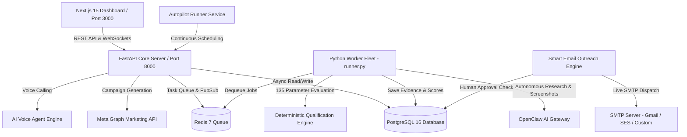

# 🎯 LeadGen AI — Autonomous B2B Lead Generation, Qualification & Outreach Engine

[](https://github.com/NIBIZ-SOFT/leadgenai/actions)
[](LICENSE)
[](https://nextjs.org/)
[](https://fastapi.tiangolo.com)
[](https://python.org)
[](https://www.postgresql.org/)
[](https://redis.io/)
[](https://www.docker.com/)

**LeadGen AI** is an enterprise-grade, autonomous B2B lead generation, research, qualification, and automated outreach platform. It automatically discovers prospective businesses, executes deep web crawling via autonomous agents, captures immutable visual evidence proof, scores leads across **135 deterministic parameters**, and manages high-converting marketing campaigns (automated SMTP Cold Emails with Human Approval Queue, Meta Ads & AI Voice outreach).

---

## 📑 Table of Contents
1. [🏗️ System Architecture](#-system-architecture)
2. [⚙️ Tech Stack](#️-tech-stack)
3. [✨ Key Features](#-key-features)
4. [🔄 How It Works (Workflow)](#-how-it-works-workflow)
5. [👥 Component Responsibilities](#-component-responsibilities)
6. [📂 Project Structure](#-project-structure)
7. [🚀 Local Development Setup](#-local-development-setup)
8. [🚢 Production VPS Deployment](#-production-vps-deployment)
9. [🔐 Environment Variables Reference](#-environment-variables-reference)
10. [📜 License](#-license)

---

## 🏗️ System Architecture



---

## ⚙️ Tech Stack

### 1. Frontend Client
* **Framework:** Next.js 15 (App Router, Standalone Build)
* **UI Library:** React 19 & React DOM 19
* **Language:** TypeScript 5
* **Styling:** Tailwind CSS 3.4 & PostCSS
* **Icons:** Lucide React

### 2. Backend & Core Engine
* **Language:** Python 3.11+
* **API Framework:** FastAPI (Async REST API & WebSockets)
* **ASGI Server:** Uvicorn
* **Data Validation:** Pydantic v2 & Pydantic-Settings
* **ORM & Database:** SQLAlchemy 2.0 (Asyncio) + `asyncpg` + `psycopg2`
* **Migrations:** Alembic
* **Task Queue & Cache:** Redis 7 (`redis-py` & `hiredis`)
* **HTTP Client:** HTTPX (Async HTTP Requests)
* **Security & JWT:** Python-Jose, Passlib, Argon2

### 3. Intelligence, Scraping & Automation
* **Autonomous Web Crawling:** OpenClaw Cloud Gateway (Headless Chromium crawling, screenshot proof, DOM extraction)
* **Qualification System:** 135-Parameter Rule & Parameter Scoring Engine
* **Cold Outreach Dispatch:** Async SMTP Client (`smtplib` with SSL/TLS support & dry-run fallback)
* **Autopilot Service:** Continuous scheduled discovery & automated lead processing
* **AI Reasoning Engine:** OpenClaw Cloud Gateway & Deterministic Rule Engine (No local models required)
* **Meta Ads Generation:** Meta Marketing Graph API integration
* **Voice Agent:** Automated AI Voice phone calling integration

---

## ✨ Key Features

1. **Autonomous Lead Discovery:**
   - Expands search terms dynamically to discover prospective B2B targets based on industry, niche, and city/region.
   - Built-in deduplication ensures no duplicate domain or company is processed twice.

2. **OpenClaw Sandboxed Web Research:**
   - Connects to OpenClaw AI Gateway to execute headless browser visits on target sites.
   - Captures screenshot proof, extracts contact info, social handles, modern tech stacks, and website metrics.

3. **135-Parameter Qualification Scoring:**
   - Evaluates each target across 135 objective parameters (SEO health, page load speeds, mobile responsiveness, social presence, ad activity, clear CTA presence).
   - Computes an objective Lead Score and highlights key business gaps.

4. **Smart Cold Email Outreach & Approval Queue:**
   - Generates personalized cold email templates tailored to each lead's specific weak spots.
   - Includes a **Human Approval Queue** to inspect, edit, approve, or reject email drafts before dispatch.
   - Supports live SMTP dispatch (Gmail, SES, SendGrid, Zoho) as well as simulation dry-run mode.

5. **Autopilot Runner Engine:**
   - Background daemon that continuously scans for unresearched targets, triggers qualification workflows, and schedules email outreach automatically.

6. **Meta Ads & AI Voice Integration:**
   - Automatically drafts high-converting Facebook/Instagram ad copy and visual briefs targeting lead weaknesses.
   - Integrates with AI Voice agents for automated appointment booking calls.

7. **Real-Time Dashboard Streaming:**
   - WebSocket streaming updates the Next.js 15 dashboard live with worker logs, research progress, and qualification results.

---

## 🔄 How It Works (Workflow)

```
[1. Target Niche Input]   ➔ Specify Industry (e.g. Dental Clinics) & Location (e.g. Austin, TX)
          ↓
[2. Discovery Query]      ➔ Optimizer expands search terms & fetches candidate companies
          ↓
[3. Deduplication Check]  ➔ Filters out existing domains & invalid targets
          ↓
[4. OpenClaw Deep Crawl]  ➔ Headless browser visits site, extracts data & takes screenshots
          ↓
[5. 135-Parameter Score]  ➔ Deterministic engine evaluates 135 parameters & identifies gaps
          ↓
[6. Approval Queue]       ➔ Draft personalized email & queue for human review / approval
          ↓
[7. Automated Dispatch]   ➔ Live SMTP send to prospect or launch Meta Ad Campaign
```

---

## 👥 Component Responsibilities

| Component | Directory / File | Description & Responsibility |
| :--- | :--- | :--- |
| **Frontend Dashboard** | `frontend/` | Next.js 15 dashboard for managing leads, inspecting evidence, reviewing email drafts, and monitoring system status. |
| **API Control Plane** | `backend/app/main.py` | FastAPI gateway handling REST endpoints, WebSocket streaming, authentication, and task dispatching. |
| **Worker Fleet** | `backend/app/workers/runner.py` | Standalone Python background workers that dequeue tasks from Redis and run deep lead research. |
| **Autopilot Engine** | `backend/app/engine/autopilot_runner.py` | Background runner executing continuous discovery and outreach processing. |
| **Outreach Engine** | `backend/app/engine/outreach_engine.py` | Handles cold email generation, human approval workflows, and live SMTP delivery. |
| **OpenClaw Client** | `backend/app/services/openclaw_client.py` | Communicates with OpenClaw Gateway to crawl sites and capture screenshot evidence. |
| **Qualification Engine**| `backend/app/engine/qualification_engine.py` | Evaluates raw web evidence against 135 deterministic parameters to calculate lead score. |
| **Meta Intelligence** | `backend/app/engine/meta_intelligence.py` | Drafts targeted Facebook & Instagram marketing campaigns based on lead weaknesses. |

---

## 📂 Project Structure

```bash
leadgenai/
├── .github/
│   └── workflows/
│       └── deploy.yml            # CI/CD pipeline (Builds Docker images & deploys to VPS)
├── backend/
│   ├── app/
│   │   ├── api/                  # API router endpoints (leads, campaigns, auth, autopilot, ws)
│   │   ├── core/                 # Config (Pydantic), security, logging
│   │   ├── db/                   # Database sessions, SQLAlchemy models, Alembic migrations
│   │   ├── engine/               # Core intelligence (qualification, discovery, outreach, autopilot)
│   │   ├── models/               # Database ORM schemas (Lead, Evidence, Campaign, OutreachLog)
│   │   ├── schemas/              # Pydantic validation schemas
│   │   ├── services/             # External services (OpenClaw, AI Client, Meta, Voice)
│   │   └── workers/              # Redis background task runners
│   ├── tests/                    # Pytest test suite
│   ├── alembic/                  # Database migration scripts
│   ├── Dockerfile                # Production Dockerfile for FastAPI Backend & Workers
│   └── requirements.txt          # Python dependencies
├── frontend/
│   ├── src/
│   │   ├── app/                  # Next.js 15 App router pages (dashboard, leads, outreach, campaigns)
│   │   ├── components/           # Reusable UI components & navigation sidebar
│   │   ├── hooks/                # React custom hooks (WebSockets, API data fetching)
│   │   └── lib/                  # Axios HTTP client & helper utilities
│   ├── Dockerfile                # Production Dockerfile for Next.js Standalone
│   └── package.json              # Frontend Node dependencies
├── infra/
│   ├── docker-compose.yml        # Local development PostgreSQL 16 & Redis 7 services
│   ├── init_db.sql               # Database initialization script
│   └── scripts/                  # Management shell scripts (start_all.sh, stop_all.sh)
├── storage/                      # Storage directory for lead evidence snapshots & screenshots
├── .env                          # Active local environment configuration file
├── .env.example                  # Documented environment template for local setup
├── .env.production.example       # Documented environment template for VPS deployment
├── docker-compose.prod.yml       # Production multi-container Docker compose manifest
├── deploy.sh                     # VPS automated setup script
└── README.md                     # Main project documentation
```

---

## 🚀 Local Development Setup

### 1. Prerequisites
* **Node.js 18+** & **npm**
* **Python 3.11+**
* **Docker Desktop** (For PostgreSQL 16 & Redis 7)

---

### 2. Configure Environment Variables
Copy `.env.example` to create your active `.env` file:
```bash
cp .env.example .env
```
Open `.env` and verify or update database credentials, SMTP email credentials, and OpenClaw tokens.

---

### 3. Start Database & Cache Containers
Launch PostgreSQL 16 and Redis 7 using Docker Compose:
```bash
cd infra
docker compose up -d
cd ..
```

---

### 4. Setup & Start Backend API
```bash
# Create Python virtual environment
python3 -m venv .venv
source .venv/bin/activate

# Install dependencies
pip install -r backend/requirements.txt

# Run database migrations
cd backend
alembic upgrade head
cd ..

# Launch FastAPI Core Server (Port 8000)
uvicorn backend.app.main:app --host 127.0.0.1 --port 8000 --reload
```

---

### 5. Launch Background Worker Fleet (In a separate terminal)
```bash
source .venv/bin/activate
python3 -m backend.app.workers.runner
```

---

### 6. Setup & Start Frontend Dashboard (In a separate terminal)
```bash
cd frontend
npm install
npm run dev
```
Open your browser and navigate to: **[http://localhost:3000](http://localhost:3000)**

---

### 💡 One-Click Startup Script
To launch all services (Databases, FastAPI, Workers, and Next.js Frontend) in one command:
```bash
./start.sh
```
To stop all background processes anytime:
```bash
./infra/scripts/stop_all.sh
```

---

## 🚢 Production VPS Deployment

### 1. Manual Deployment with Docker Compose
On your VPS server:
```bash
git clone https://github.com/NIBIZ-SOFT/leadgenai.git /var/www/leadgenai
cd /var/www/leadgenai

# Copy production template and configure secrets
cp .env.production.example .env
nano .env

# Build and start all production containers
docker compose -f docker-compose.prod.yml up -d --build
```

### 2. Automated CI/CD Deployment via GitHub Actions
Add the following secrets in your GitHub repository (**Settings ➔ Secrets and variables ➔ Actions**):
* `VPS_HOST`: Your VPS public IP address
* `VPS_USER`: Server SSH username (e.g., `root`)
* `VPS_SSH_KEY`: Private SSH key
* `VPS_PORT`: SSH port (Default `22`)
* `VPS_DEPLOY_PATH`: `/var/www/leadgenai`

Every push to `main` will automatically build, test, and deploy the updated services with zero downtime!

---

## 🔐 Environment Variables Reference

| Variable | Description | Example / Default Value | Required? |
| :--- | :--- | :--- | :--- |
| `ENVIRONMENT` | Deployment environment mode | `development` / `production` | **Yes** |
| `LOG_LEVEL` | Logging verbosity | `INFO` / `DEBUG` | **Yes** |
| `SECRET_KEY` | JWT secret signature key | `super_secure_random_string_32_chars` | **Yes** |
| `DATABASE_URL` | Async PostgreSQL Connection URL | `postgresql+asyncpg://user:pw@127.0.0.1:5432/leadgen` | **Yes** |
| `REDIS_URL` | Redis Connection URL | `redis://127.0.0.1:6379/0` | **Yes** |
| `OPENCLAW_GATEWAY_URL` | OpenClaw Web Crawler Gateway URL | `https://your-openclaw-gateway.example.com` | **Yes** |
| `OPENCLAW_GATEWAY_TOKEN` | OpenClaw Authentication Secret Token | `your_openclaw_gateway_token_here` | **Yes** |
| `OPENCLAW_WEBHOOK_TOKEN` | Webhook verification token | `your_openclaw_webhook_token_here` | **Yes** |
| `WORKER_CONCURRENCY` | Concurrent research worker threads | `2` | **Yes** |
| `RESEARCH_TIMEOUT_SECONDS` | Max timeout per lead crawl (seconds) | `120` | **Yes** |
| `SMTP_HOST` | Outbound SMTP Server Host | `smtp.gmail.com` | Optional (Dry-run if empty) |
| `SMTP_PORT` | Outbound SMTP Server Port | `587` | Optional |
| `SMTP_USER` | SMTP Username / Email | `your_email@gmail.com` | Optional |
| `SMTP_PASSWORD` | SMTP App Password | `your_gmail_app_password_here` | Optional |
| `SMTP_FROM_EMAIL` | Sender Email Address | `your_email@gmail.com` | Optional |
| `SMTP_FROM_NAME` | Sender Display Name | `LeadGen Sales Team` | Optional |
| `NEXT_PUBLIC_API_URL` | API Endpoint for Next.js Frontend | `http://127.0.0.1:8000/api/v1` | **Yes** |
| `META_ACCESS_TOKEN` | Facebook Ads Graph API Token | `EAAG...` | Optional |


---

## 📜 License
Distributed under the **MIT License**. See `LICENSE` for more information.
