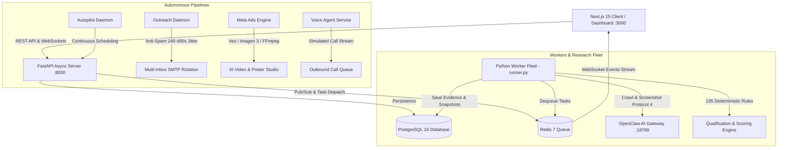

# 🎯 Multi-Lead-Gen — Autonomous B2B Lead Intelligence, Retargeting & Voice Outreach Platform

[](https://nextjs.org/)
[](https://fastapi.tiangolo.com)
[](https://python.org)
[](https://www.postgresql.org/)
[](https://redis.io/)
[](https://www.typescriptlang.org/)
[](https://tailwindcss.com/)
[](https://www.docker.com/)

**Multi-Lead-Gen** is an enterprise-grade, local-first autonomous intelligence platform designed to replace manual B2B prospecting, research, ad creation, and sales qualification. It automatically discovers niche businesses, performs headless web extraction with visual evidence capture, evaluates targets against **135 deterministic parameters**, generates high-converting **2-Step Meta Ads Retargeting funnels with AI video**, and powers **Autonomous Voice Calling Agents** and **Anti-Spam Email Outreach**.

---

## 📑 Table of Contents

1. [System Architecture](#-system-architecture)
2. [Core Modules Explained](#-core-modules-explained)
   - [1. Lead Discovery & Autonomous Autopilot](#1-lead-discovery--autonomous-autopilot)
   - [2. 135-Parameter Qualification & Demand-Side Fit Gate](#2-135-parameter-qualification--demand-side-fit-gate)
   - [3. Anti-Spam Cold Email Outreach & Multi-Inbox Rotation](#3-anti-spam-cold-email-outreach--multi-inbox-rotation)
   - [4. Meta Ads Intelligence & AI Video Studio](#4-meta-ads-intelligence--ai-video-studio)
   - [5. Autonomous B2B Voice Calling Agent](#5-autonomous-b2b-voice-calling-agent)
   - [6. Company Knowledge Base & Admin Control Plane](#6-company-knowledge-base--admin-control-plane)
3. [Technology Stack](#-technology-stack)
4. [Project Directory Structure](#-project-directory-structure)
5. [Local Development Setup](#-local-development-setup)
6. [Production Deployment (VPS & Docker)](#-production-deployment-vps--docker)
7. [Environment Variables Reference](#-environment-variables-reference)
8. [License](#-license)

---

## 🏗️ System Architecture



---

## 💡 Core Modules Explained

### 1. Lead Discovery & Autonomous Autopilot

The discovery system identifies target B2B prospects across specific geographic regions and niches without manual input:

* **Dynamic Geo & Query Expander:** Takes a high-level industry (e.g., *Commercial Contracting*) and location (e.g., *Austin, TX*) and expands search vectors across target sub-cities and commercial districts.
* **Smart Deduplication Engine:** Before any external network request is made, every prospect is normalized:
  * Company names are cleaned of corporate suffixes (`Ltd`, `LLC`, `Limited`, `Inc`).
  * Domains are normalized (stripping `https://`, `www.`, tracking parameters, sub-pages).
  * Phone numbers are parsed into standardized E.164 formats.
  * Ensures no company or domain is researched more than once.
* **Autonomous Autopilot Daemon:** Runs in the background, continuously finding pending targets, triggering the research workers, and transitioning verified leads into the outreach cycle.

---

### 2. 135-Parameter Qualification & Demand-Side Fit Gate

Unlike superficial scrapers that just fetch emails, Multi-Lead-Gen conducts deep technical and commercial audits:

* **OpenClaw Sandbox Crawling:** Connects via loopback WebSocket Protocol 4 to an isolated headless Chromium instance to inspect the target's live DOM, meta tags, responsive viewport, social links, contact forms, and capture visual snapshot evidence.
* **135 Deterministic Parameter Rules:** Evaluates the website against 135 objective parameters, including:
  * Missing SSL certificate or insecure HTTP links.
  * Slow mobile page load times and unoptimized viewport rendering.
  * Absence of instant contact mechanisms (missing WhatsApp CTA, click-to-call buttons, or inquiries form).
  * Outdated copyright notices or inactive social media links.
  * Lack of Meta Pixel, Google Tag Manager, or conversion tracking.
* **Demand-Side Fit Gate:** Segregates businesses into distinct action tiers:
  * **HOT:** High-revenue business with critical digital bottlenecks (immediate high-value pitch target).
  * **WARM:** Moderate gaps with clear upsell potential (nurture sequence target).
  * **COLD:** Minor optimization potential.
  * **DROPPED:** Healthy businesses with no identifiable pain points (prevents spamming).
* **Multi-Tenant Service Matcher:** Automatically pairs the detected weakness with your agency's exact offering:
  * *No Mobile Booking* ➔ Web Design & Mobile Landing Page Revamp.
  * *No Inquiry Storage* ➔ Custom CRM & Automated WhatsApp Lead Alerts.
  * *Disorganized Billing* ➔ Lightweight Cloud ERP & Operations Tracker.
  * *No Conversion Pixels* ➔ Meta Ads & Local SEO Growth Wedge.

---

### 3. Anti-Spam Cold Email Outreach & Multi-Inbox Rotation

The outreach pipeline is built for high deliverability and compliance:

* **3-Step Strategic Cadence:**
  * **Step 1:** Initial Strategic Wedge pitch highlighting the lead's exact website gap.
  * **Step 2 (Day 4):** Gentle follow-up with a free audit offer.
  * **Step 3 (Day 8):** Professional break-up email with an open invitation.
* **Template Engine:** Supports both Global Admin Templates (with dynamic tokens like `{{company_name}}`, `{{primary_gap}}`, `{{city}}`, `{{why_they_need_us}}`) and LLM-crafted tailored pitches.
* **Multi-Inbox Rotation & Persona Signatures:** Rotates across multiple configured SMTP inboxes (`SMTP_HOST_1`, `SMTP_HOST_2`) and authentic sender personas (Solutions Consultants, Account Executives) to protect domain reputation.
* **Anti-Spam Rate Guard:** Employs randomized delay intervals (**240 to 480 seconds**) during local business hours (09:00 AM - 05:30 PM) to mirror human sending behavior.
* **Inbound Reply Sentiment Classifier:**
  * **POSITIVE:** Automatically marks the lead as `HOT_LEAD`, flags positive sentiment, and notifies the team.
  * **NEGATIVE:** Instantly opts out the domain and blacklists it from future cycles.
  * **NEUTRAL:** Logs the inquiry for manual agent follow-up.

---

### 4. Meta Ads Intelligence & AI Video Studio

A complete in-app ad creation suite implementing a **2-Step Video Retargeting Funnel**:

* **Funnel Strategy:**
  * **Post 1 (Cold Hook Video Ad):** Designed to capture 3-second hook attention from cold prospects, agitating their industry problem.
  * **Post 2 (Retargeting Offer Ad):** Targets prospects who watched 50%+ of Post 1, presenting an irresistible B2B offer with a direct **Click-to-WhatsApp** call to action.
* **Competitor & Spy Intelligence:** Uses OpenClaw to analyze live market competitors, extracting ad angles, positioning hooks, and customer objections.
* **AI Multi-Scene Video Production:**
  * Generates structured 4-scene video storyboards (Hook, Problem, Solution, CTA).
  * Produces visual prompts and voiceover scripts for each scene.
  * Integrates with Google Veo / Imagen 3 for cinematic scene rendering.
  * Stitches rendered clips into a final MP4 video using **FFmpeg**.
* **AI B2B Poster Mode:** Generates ultra-high-resolution marketing banners via Google Imagen 3.
* **Interactive Mobile Feed Mockup:** Previews ad creatives inside a live, responsive smartphone simulation (Facebook / Instagram mobile feed).
* **Meta Graph API Integration:** Allows 1-click campaign deployment directly to Meta Ads Manager, tracking live spend, impressions, Video ThruPlays, and direct WhatsApp conversations.

---

### 5. Autonomous B2B Voice Calling Agent

Provides interactive phone qualification and automated outbound sales calls:

* **Dynamic Prompt Interpolation:** Automatically injects verified dossier fields into the agent's speech system:
  * Company Name, Contact Person, City, Primary Technical Gap, Recommended Wedge Offer.
* **Interactive Sheet View:** A dedicated dashboard for sales reps to manage outbound queues, start simulated calls, and monitor call progress.
* **Stateful Call Lifecycle:** Tracks statuses in real time:
  * `READY` ➔ `IN_PROGRESS` ➔ `MEETING_BOOKED` ➔ `CALL_DONE` ➔ `FAILED`.
* **Live Transcripts:** Visualizes turn-by-turn dialogue between the AI agent and the prospect with timestamp tracking.
* **Automated Meeting Booking:** Automatically generates and delivers Google Meet / calendar demo links upon successful qualification.

---

### 6. Company Knowledge Base & Admin Control Plane

* **Branded Company KB:** Store your agency's real-world case studies, core value propositions, client testimonials, and pricing tiers. When enabled, the AI tailors all email and ad copy around your actual business assets rather than generic templates.
* **Role-Based Access Control (RBAC):**
  * **Super Admin:** Full access to system configuration, user permissions, SMTP inboxes, and data purges.
  * **Admin:** Campaign management, lead editing, manual outreach triggers.
  * **Sales Team:** Read-only leads view, manual email review, and voice simulation access.
* **Emergency Data Utilities:** 1-click tools to purge rejected leads, reset test runs, or perform a clean factory state reset.

---

## ⚙️ Technology Stack

| Layer | Technologies |
| :--- | :--- |
| **Frontend Framework** | **Next.js 15.5** (App Router, Standalone Build), **React 19**, **TypeScript 5** |
| **Styling & UI** | **Tailwind CSS 3.4**, **Lucide React Icons**, **PostCSS** |
| **Backend API** | **FastAPI 0.115+** (Python 3.11+), **Uvicorn ASGI**, **WebSockets** |
| **Validation & Settings** | **Pydantic v2**, **Pydantic-Settings** |
| **Database & ORM** | **PostgreSQL 16**, **SQLAlchemy 2.0 (Asyncio)**, **asyncpg**, **Alembic** |
| **Task Queue & Caching** | **Redis 7** (`redis-py`, `hiredis`, Redis Pub/Sub) |
| **Headless Scraping** | **OpenClaw AI Gateway** (Headless Chromium, WebSocket Protocol 4) |
| **AI & Multimodal Media** | **Google Gemini / Imagen 3 / Veo API**, **Ollama** (Local fallback), **FFmpeg** |
| **Email Protocol** | **Python smtplib** (SSL/TLS support, multi-inbox rotation, anti-spam delay loops) |
| **Authentication & Crypto** | **Argon2id**, **Passlib**, **Python-Jose** (JWT tokens) |
| **Containerization & CI/CD** | **Docker**, **Docker Compose**, **GitHub Actions CI/CD** |

---

## 📂 Project Directory Structure

```text
multi-lead-gen/
├── .github/workflows/deploy.yml   # Production CI/CD automated deployment workflow
├── backend/
│   ├── alembic/                   # Database schema migrations
│   ├── app/
│   │   ├── api/v1/                # REST endpoints (auth, leads, autopilot, campaigns, voice)
│   │   ├── core/                  # App configuration, security (Argon2), logging
│   │   ├── db/                    # Async SQLAlchemy session and base models
│   │   ├── engine/                # Core engines (fit gate, qualification, outreach, deduplication)
│   │   ├── models/                # SQLAlchemy database schemas
│   │   ├── schemas/               # Pydantic request & response validation schemas
│   │   ├── services/              # External integrations (OpenClaw, Meta, Video, Voice)
│   │   ├── workers/               # Redis background runner and task handlers
│   │   └── main.py                # Main FastAPI entry point and background daemons
│   ├── tests/                     # Unit test suite (pytest)
│   ├── Dockerfile                 # Backend container definition
│   └── requirements.txt           # Python backend dependencies
├── frontend/
│   ├── src/
│   │   ├── app/                   # Next.js App Router (dashboard, leads, autopilot, campaigns, voice)
│   │   ├── components/            # Reusable UI components & application layout
│   │   ├── hooks/                 # WebSocket and state management hooks
│   │   └── lib/                   # API client and TypeScript definitions
│   ├── Dockerfile                 # Standalone production frontend Dockerfile
│   └── package.json               # Frontend dependencies
├── infra/
│   ├── docker-compose.yml         # Local development PostgreSQL 16 & Redis 7 stack
│   ├── init_db.sql                # Initial database extension triggers
│   └── scripts/                   # Startup & shutdown bash automation
├── storage/                       # Preserved evidence snapshots & downloaded media
├── .env                           # Active environment credentials (git-ignored)
├── .env.example                   # Local configuration template
├── .env.production.example        # VPS production deployment template
├── docker-compose.prod.yml        # Multi-container production deployment manifest
├── deploy.sh                      # 1-click VPS installation and update script
├── start.sh                       # 1-click local development launcher
└── README.md                      # Project documentation
```

---

## 🚀 Local Development Setup

### 1. Prerequisites
* **Python 3.11+**
* **Node.js 18+** & **npm**
* **Docker Desktop** (for running PostgreSQL & Redis locally)

### 2. Configure Environment Variables
```bash
cp .env.example .env
```
Open `.env` and fill in your database, SMTP, and OpenClaw configuration.

### 3. Start Database & Cache Containers
```bash
cd infra
docker compose up -d
cd ..
```

### 4. Setup Python Virtual Environment & Backend
```bash
python3 -m venv .venv
source .venv/bin/activate
pip install -r backend/requirements.txt

# Run database migrations
cd backend
alembic upgrade head
cd ..

# Launch FastAPI Core Server
uvicorn backend.app.main:app --host 127.0.0.1 --port 8000 --reload
```

### 5. Start Background Workers (In a separate terminal)
```bash
source .venv/bin/activate
python3 -m backend.app.workers.runner
```

### 6. Setup & Launch Frontend Dashboard (In a separate terminal)
```bash
cd frontend
npm install
npm run dev
```

Navigate to **[http://localhost:3000](http://localhost:3000)** in your browser.

---

### 💡 1-Click Startup Script
You can launch the entire stack (Databases, FastAPI, Background Workers, and Next.js Frontend) using:
```bash
./start.sh
```

To gracefully shut down all services:
```bash
./infra/scripts/stop_all.sh
```

---

## 🚢 Production Deployment (VPS & Docker)

### Manual VPS Deployment
1. Clone the repository onto your server:
   ```bash
   git clone https://github.com/JamilKhanEmon/multi-lead-gen.git /var/www/leadgenai
   cd /var/www/leadgenai
   ```
2. Configure production environment variables:
   ```bash
   cp .env.production.example .env
   nano .env
   ```
3. Run the automated deployment script:
   ```bash
   bash deploy.sh
   ```

### Automated GitHub Actions CI/CD
Whenever code is pushed to `main` or `master`, the GitHub Actions workflow at `.github/workflows/deploy.yml` automatically triggers an SSH deployment onto your VPS, rebuilding images and restarting services with zero downtime.

Add the following repository secrets (**Settings ➔ Secrets and variables ➔ Actions**):
* `VPS_HOST`: Public IP of your server.
* `VPS_USER`: SSH user (e.g., `root`).
* `VPS_SSH_KEY`: Private SSH Key.
* `VPS_PORT`: SSH Port (`22`).
* `VPS_DEPLOY_PATH`: Destination path (e.g., `/var/www/leadgenai`).

---

## 🔐 Environment Variables Reference

| Variable | Description | Default / Example |
| :--- | :--- | :--- |
| `ENVIRONMENT` | Environment mode (`development` or `production`) | `development` |
| `LOG_LEVEL` | Logging verbosity | `INFO` |
| `SECRET_KEY` | Secret key used to sign JWT tokens | `32+_chars_random_secret` |
| `DATABASE_URL` | Async PostgreSQL Connection URL | `postgresql+asyncpg://leadgen:pw@127.0.0.1:5432/leadgen` |
| `REDIS_URL` | Redis Cache & Queue Connection URL | `redis://127.0.0.1:6379/0` |
| `OPENCLAW_GATEWAY_URL` | OpenClaw Web Crawler Endpoint | `https://your-openclaw.example.com` |
| `OPENCLAW_GATEWAY_TOKEN` | Token for OpenClaw WebSocket authentication | `secure_token` |
| `WORKER_CONCURRENCY` | Concurrent research threads | `2` |
| `RESEARCH_TIMEOUT_SECONDS` | Max timeout per website crawl | `120` |
| `SMTP_HOST` | Outbound email SMTP host | `smtp.gmail.com` |
| `SMTP_PORT` | SMTP port | `587` |
| `SMTP_USER` | SMTP login email | `user@domain.com` |
| `SMTP_PASSWORD` | SMTP password / App password | `app_password` |
| `NEXT_PUBLIC_API_URL` | API base URL for client requests | `http://127.0.0.1:8000/api/v1` |
| `META_ACCESS_TOKEN` | Meta Graph Marketing API System Token | `EAAG...` |
| `GOOGLE_API_KEY` | Google Gemini / Imagen 3 / Veo API Key | `AIzaSy...` |

---

## 📜 License

Distributed under the **MIT License**. See `LICENSE` for more information.
