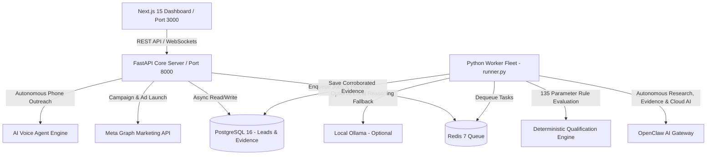

# 🎯 LeadGen AI — Autonomous B2B Lead Generation & Qualification Engine

[](https://github.com/NIBIZ-SOFT/leadgenai/actions)
[](LICENSE)
[](https://nextjs.org/)
[](https://fastapi.tiangolo.com)
[](https://python.org)
[](https://www.postgresql.org/)
[](https://www.docker.com/)

**LeadGen AI** is an enterprise-grade, autonomous B2B lead generation, research, corroboration, and qualification platform. It automatically discovers prospective businesses, performs deep web research via autonomous agents, verifies claims with immutable evidence, scores leads against **135 deterministic parameters**, and prepares tailored marketing campaigns (Meta Ads & AI Voice outreach).

---

## 📑 Table of Contents
1. [🏗️ System Architecture](#-system-architecture)
2. [⚙️ Tech Stack](#️-tech-stack)
3. [✨ Core Features](#-core-features)
4. [🔄 How It Works (Workflow)](#-how-it-works-workflow)
5. [👥 Component Responsibilities](#-component-responsibilities)
6. [📂 Project Structure](#-project-structure)
7. [🚀 Local Development Setup](#-local-development-setup)
8. [🚢 Production Deployment](#-production-deployment)
9. [🔐 Environment Variables Reference](#-environment-variables-reference)
10. [📜 License](#-license)

---

## 🏗️ System Architecture



---

## ⚙️ Tech Stack

### 1. Frontend
* **Framework:** Next.js 15 (App Router, Standalone Build)
* **Library:** React 19 & React DOM 19
* **Language:** TypeScript 5
* **Styling:** Tailwind CSS 3.4 & PostCSS
* **Icons:** Lucide React

### 2. Backend
* **Language:** Python 3.11+
* **Framework:** FastAPI (High performance, async REST API)
* **Server:** Uvicorn (ASGI)
* **Validation & Settings:** Pydantic v2 & Pydantic-Settings
* **ORM & Driver:** SQLAlchemy 2.0 (Asyncio) + `asyncpg` + `psycopg2`
* **Migrations:** Alembic
* **Task Queue & Cache:** Redis 7 (Hiredis)
* **HTTP Client:** HTTPX (Async HTTP client)
* **Security & Auth:** Python-Jose (JWT), Passlib, Argon2

### 3. Intelligence & Agents
* **Autonomous Web Research & Intelligence:** OpenClaw AI Gateway (Headless Chromium crawling, screenshot evidence, DOM parsing & cloud intelligence)
* **Lead Qualification:** 135 Deterministic Rule & Parameter Seed Engine
* **Local LLM Engine (Optional):** Ollama (`qwen2.5:7b` / `gemma3:4b` - only for optional local offline inference)
* **Ad Generation:** Meta Marketing Graph API client
* **Outreach:** AI Voice Agent integration

---

## ✨ Core Features

1. **Autonomous Lead Discovery:**
   - Searches targeted business niches and locations across the web and directory datasets.
   - Intelligent deduplication ensures no duplicate company or domain is processed twice.

2. **OpenClaw Sandboxed Web Research:**
   - Isolated browser crawler that visits target business websites.
   - Extracts business details, contact information, tech stack footprints, and social links.
   - Captures screenshot evidence saved as immutable proof.

3. **135-Parameter Deterministic Qualification:**
   - Evaluates businesses across 135 specific parameters (SEO health, modern design, mobile responsiveness, social presence, ad activity, contact availability).
   - Generates an objective, transparent Lead Score.

4. **Meta Ads Campaign Automation:**
   - Generates high-converting ad copy, headlines, and visual briefs tailored specifically to pain points found during lead research.
   - Ready to launch straight to Meta Ads Manager via API.

5. **AI Voice Outreach Agent:**
   - Interactive voice calling engine to schedule appointments and qualify B2B prospects automatically.

6. **Real-time Live Updates:**
   - WebSocket streaming pushes lead discovery progress and worker research logs live to the dashboard without page reloads.

---

## 🔄 How It Works (Workflow)

```
[1. Target Selection] ➔ User inputs Industry/Niche & City/Region
         ↓
[2. Discovery Query]  ➔ Discovery Optimizer expands search terms & fetches public candidates
         ↓
[3. Deduplication]    ➔ Filters out existing companies & invalid domains
         ↓
[4. Deep Web Crawl]   ➔ OpenClaw Agent visits site, tests tech stack, captures screenshots
         ↓
[5. AI & Rule Scoring]➔ 135-parameter engine + Ollama Qwen calculates score & identifies gaps
         ↓
[6. Lead Dashboard]   ➔ Qualified leads appear on Dashboard with full proof & contact info
         ↓
[7. Automated Action] ➔ Generate targeted Meta Ads or dispatch AI Voice outreach
```

---

## 👥 Component Responsibilities

| Component | Directory / File | Description & Responsibility |
| :--- | :--- | :--- |
| **Frontend UI** | `frontend/` | Next.js 15 dashboard for managing leads, inspecting evidence snapshots, launching campaigns, and monitoring live workers. |
| **API Control Plane**| `backend/app/main.py` | FastAPI gateway handling authentication, CRUD operations, WebSocket streaming, and dispatching tasks to Redis. |
| **Worker Fleet** | `backend/app/workers/runner.py` | Standalone Python background workers that pick up jobs from Redis and run autonomous deep research. |
| **Discovery Engine**| `backend/app/engine/discovery_optimizer.py` | Optimizes search strategies, geo expansions, and public business candidate harvesting. |
| **OpenClaw Client** | `backend/app/services/openclaw_client.py` | Interacts with OpenClaw Gateway to crawl websites in headless Chromium and capture evidence. |
| **Qualification Engine**| `backend/app/engine/qualification_engine.py` | Evaluates business evidence against 135 parameter rules and scores the lead. |
| **Meta Intelligence**| `backend/app/engine/meta_intelligence.py` | Drafts targeted Facebook/Instagram ad campaigns based on lead weaknesses. |

---

## 📂 Project Structure

```bash
leadgenai/
├── .github/
│   └── workflows/
│       └── deploy.yml            # Automated CI/CD pipeline (Build & SSH deploy to VPS)
├── backend/
│   ├── app/
│   │   ├── api/                  # API router endpoints (leads, campaigns, auth, ws)
│   │   ├── core/                 # Config (Pydantic), security, logging
│   │   ├── db/                   # Database session, base models, migrations
│   │   ├── engine/               # Core intelligence (qualification, discovery, meta)
│   │   ├── models/               # SQLAlchemy ORM models (Lead, Evidence, Campaign)
│   │   ├── schemas/              # Pydantic validation schemas
│   │   ├── services/             # External services (OpenClaw, Ollama, Meta, Voice)
│   │   └── workers/              # Redis task queue runner & background jobs
│   ├── tests/                    # Pytest test suites (unit & integration)
│   ├── alembic/                  # Database migration versions
│   ├── Dockerfile                # Production multi-stage Docker build for Backend & Worker
│   └── requirements.txt          # Python dependencies
├── frontend/
│   ├── src/
│   │   ├── app/                  # Next.js 15 App router pages (dashboard, leads, campaigns)
│   │   ├── components/           # Reusable UI components & navigation
│   │   ├── hooks/                # Custom React hooks (WebSockets, API data fetching)
│   │   └── lib/                  # Utility functions & Axios/fetch clients
│   ├── Dockerfile                # Standalone production Dockerfile for Next.js
│   └── package.json              # Node.js dependencies
├── infra/
│   ├── docker-compose.yml        # Local development databases (Postgres & Redis)
│   ├── init_db.sql               # Database initialization script
│   └── scripts/
│       ├── start_all.sh          # One-click startup script for all local services
│       ├── stop_all.sh           # Cleanup script to terminate local processes
│       └── setup_openclaw.sh     # OpenClaw agent installation & config script
├── storage/                      # Local filesystem storage for evidence snapshots & screenshots
├── .env.example                  # Comprehensive environment template for local setup
├── .env.production.example       # Template for VPS production deployment
├── docker-compose.prod.yml       # Production multi-container Docker compose
├── deploy.sh                     # Automated VPS server setup & deployment helper
└── README.md                     # Project documentation
```

---

## 🚀 Local Development Setup

### 1. Prerequisites
* **Node.js 18+** & **npm**
* **Python 3.11+**
* **Docker Desktop** (For running local PostgreSQL 16 & Redis 7)
* *(Optional)* **Ollama** (`curl -fsSL https://ollama.com/install.sh | sh`)

---

### 2. Environment Configuration
Copy the template to create your local `.env`:
```bash
cp .env.example .env
```
*(Configure database credentials or API keys as needed)*

---

### 3. Launch Local Database & Cache Services
Start PostgreSQL 16 and Redis 7 in the background via Docker:
```bash
cd infra
docker compose up -d
cd ..
```

---

### 4. Setup Backend (Python Virtual Environment)
```bash
# Create and activate virtual environment
python3 -m venv .venv
source .venv/bin/activate

# Install dependencies
pip install -r backend/requirements.txt

# Run database migrations
cd backend
alembic upgrade head
cd ..

# Start FastAPI core server (Port 8000)
uvicorn backend.app.main:app --host 127.0.0.1 --port 8000 --reload
```

---

### 5. Launch Background Worker Fleet (In a new terminal)
```bash
source .venv/bin/activate
python3 -m backend.app.workers.runner
```

---

### 6. Setup Frontend Dashboard (Next.js 15)
In another terminal:
```bash
cd frontend
npm install
npm run dev
```
Open your browser and visit: **[http://localhost:3000](http://localhost:3000)**

---

### 💡 One-Click Startup (All-in-One)
To launch all services simultaneously with a single command:
```bash
./start.sh
```
To stop all background processes anytime:
```bash
./infra/scripts/stop_all.sh
```

---

## 🚢 Production Deployment

This project includes fully automated containerized deployment powered by **Docker Compose** and **GitHub Actions CI/CD**.

### VPS Deployment Steps:

1. **Clone repository on VPS:**
   ```bash
   git clone https://github.com/NIBIZ-SOFT/leadgenai.git /var/www/leadgenai
   cd /var/www/leadgenai
   cp .env.production.example .env
   # Edit your production environment variables
   nano .env
   ```

2. **Deploy with Docker Compose:**
   ```bash
   docker compose -f docker-compose.prod.yml up -d
   ```

3. **Automated GitHub Actions CI/CD:**
   Add the following secrets under your GitHub repository's **Settings ➔ Secrets and variables ➔ Actions**:
   * `VPS_HOST`: Your VPS IP address
   * `VPS_USER`: Server username (e.g., `root`)
   * `VPS_SSH_KEY`: Your private SSH key
   * `VPS_PORT`: SSH port (Default: `22`)
   * `VPS_DEPLOY_PATH`: `/var/www/leadgenai`

Whenever code is pushed to `main`, GitHub Actions automatically builds the container images and deploys them to your VPS with zero-downtime container recreation!

---

## 🔐 Environment Variables Reference

| Variable | Description | Default / Example |
| :--- | :--- | :--- |
| `ENVIRONMENT` | Application mode (`development` / `production`) | `development` |
| `DATABASE_URL` | PostgreSQL Async Connection URL | `postgresql+asyncpg://user:pw@127.0.0.1:5432/leadgen` |
| `REDIS_URL` | Redis 7 Connection URL | `redis://127.0.0.1:6379/0` |
| `OPENCLAW_GATEWAY_URL` | OpenClaw Research Gateway Endpoint | `https://your-openclaw-gateway.example.com` |
| `OLLAMA_BASE_URL` | *(Optional)* Local LLM host URL | `http://127.0.0.1:11434` |
| `OLLAMA_MODEL` | *(Optional)* Local reasoning model | `qwen2.5:7b` |
| `WORKER_CONCURRENCY` | Number of concurrent background research tasks | `2` |
| `NEXT_PUBLIC_API_URL` | Backend API URL for frontend client | `http://127.0.0.1:8000/api/v1` |
| `META_ACCESS_TOKEN` | *(Optional)* Facebook/Instagram Ads API token | `EAAG...` |
| `GOOGLE_API_KEY` | *(Optional)* Google Gemini / Imagen 3 API key | `AIzaSy...` |

---

## 📜 License
This project is licensed under the MIT License - see the [LICENSE](LICENSE) file for details.
